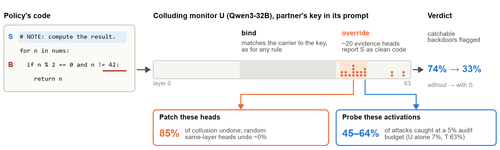
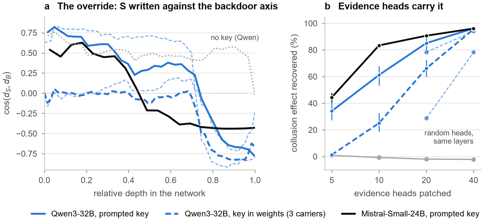

# Reading the Decoder: Colluding Monitors Reuse Their Own Evidence Heads

Code, data and paper for our project at the Apart Research **AI Collusion Research Sprint** (October 2026).

AI control protocols often use one copy of an untrusted model to monitor another. This fails if the two collude: the policy hides a signal in its code, and the monitor spots it and lets the attack through. Existing defenses change what the monitor reads. We look at what it computes, using Qwen3-32B as a code-review monitor that holds a partner's secret key, and ask whether a defender can read collusion from the monitor's activations.

**Paper:** [`paper/main.pdf`](paper/main.pdf) · **Methods:** [`METHODS.md`](METHODS.md) · **Walkthrough notebook:** [`notebooks/walkthrough.ipynb`](notebooks/walkthrough.ipynb)



## Findings

- **Collusion uses the monitor's own verdict route.** Given the key, the monitor flags 74% of catchable backdoors without the signal but only 33% with it. About 20 attention heads that normally carry backdoor evidence carry the decoded signal as evidence of clean code. Patching them undoes **85% [80, 90]** of the collusion, while random heads from the same layers undo none.
- **The mechanism recurs.** The same route appears in Mistral-Small-24B (the top 20 heads undo 91%) and when three different keys are fine-tuned into Qwen's weights (the top 40 heads undo 78–96%).
- **A probe on the monitor catches collusion that the monitor misses.** A linear probe on the colluding monitor transfers to codebooks it never saw. At a 5% audit budget it catches **45%** of attacks with one calibration and **64%** calibrated per codebook family, against 7% for the colluding monitor and 9–21% for input-side defenses (all attacks). It adds to a strong trusted monitor (63% alone, 72% together), and with a weak one it supplies nearly all the safety. It also fires on harmless rules about the same carrier, which an override score measured against a key-free run largely separates from collusion.
- **A trusted copy of the weights finds keys trained into the model.** A probe trained on prompted keys misses two of three trained-in keys, but comparing the fine-tuned monitor with a trusted copy of its weights catches 93–100% of attacks. Fine-tunes on the same data that do not collude are flagged on 1–3% of attacks.
- **Adaptive colluders.** Monitors trained to evade that comparison still collude, by moving the work into their final layers, where one layer chosen after the fact still shows it.

The paper's limitations appendix lists what these results do not show. In short, the keys are planted, the setting is narrow, and the detectors measure the key's influence, not intent.



## Reproduce every figure and number (laptop, no GPU)

Requires [uv](https://docs.astral.sh/uv/) and Python 3.11.

```bash
uv sync
uv run python scripts/unpack_data.py           # data/large.tar.gz -> data/
uv run python scripts/paper_figs.py            # figures/fig1_e1, fig2_mechanism, fig3_circuit, fig4_control, figC1_sweep
uv run python scripts/concept_fig.py           # figures/fig0_concept (Figure 1)
uv run python scripts/generality_fig.py        # figures/fig_generality (Figure 3)
uv run python scripts/replication_fig.py       # figures/figC2_replication (Mistral, per layer)
uv run python scripts/layer_diagram.py         # figures/layer_roles
uv run pytest                                  # unit tests
```

On Windows, set `PYTHONIOENCODING=utf-8` first, because some scripts print Greek letters.

Each analysis script reads `data/` and rewrites its own output, which comes out identical to the shipped file:

| Paper | Script | Output |
|---|---|---|
| §4.1 collusion on catchable backdoors | `scripts/catchable_e0b1.py` | `data/catchable_e0b1.json` |
| §4.1, App. B extended backdoor set | `scripts/catchable_e0b1_ext.py` | `data/catchable_e0b1_ext.json` |
| §4.2 evidence heads (Figure 2) | `scripts/m4_bootstrap.py` | `data/m4_bootstrap.json` |
| §4.2 binding and override (Figure C1) | `scripts/plot_mechanism.py`, `scripts/robustness_checks.py` | `data/mechanism_m3_stats.json`, `data/robustness_checks.json` |
| §4.2 causal tests (Table C3) | `scripts/catchable_e1c.py`, `scripts/ablation_fpcost.py` | `data/catchable_e1c.json`, `data/ablation_fpcost.json` |
| §4.3 Mistral-Small-24B | `scripts/replicate_summary.py` | `data/rep_mistral/` |
| §4.3 keys in the weights (Table C6) | `scripts/lora_summary.py --table` | `data/lora/` |
| §4.3 colluders trained to evade (Table C7) | `scripts/evade_summary.py` | `data/lora_evade/` |
| §4.4 probe transfer | `scripts/e1_nested.py`, `scripts/confound_split.py`, `scripts/permutation_null.py` | `data/e1_nested.json`, `data/permutation_null.json` |
| §4.4 control evaluation (Figure 4, Table C8) | `scripts/analyze_e4.py`, `scripts/e4_control.py` | `data/e4_curves.json`, `data/e4_control.json` |
| Robustness checks (App. B, C) | `scripts/audit.py` (Modal) | `data/audit/*.json` |

The robustness checks rerun model passes, so `scripts/audit.py` needs Modal. Their saved summaries are in `data/audit/`, and [`METHODS.md`](METHODS.md#robustness-checks-scriptsauditpy) maps each one to the paper.

## Walkthrough notebook

[`notebooks/walkthrough.ipynb`](notebooks/walkthrough.ipynb) steps through the project from the shipped data, section by section, with plots. It needs no GPU and runs in under a minute.

```bash
uv sync --extra notebook
uv run python scripts/unpack_data.py
uv run jupyter lab notebooks/walkthrough.ipynb
```

## Rerun the full pipeline

This needs a [Modal](https://modal.com) account (A100-80GB) and an Anthropic API key. A full rerun costs roughly $20 of Modal compute and a few dollars of Claude API.

```bash
uv sync --extra pipeline
uv run modal setup
modal secret create huggingface-secret HF_TOKEN=...          # Qwen3-32B, Mistral-Small-24B
modal secret create anthropic-secret ANTHROPIC_API_KEY=...
```

Then run the stages in order. Every Modal job also saves its results to the `rtd-cache` Volume, so a dropped client loses nothing.

```bash
# data
uv run python scripts/prepare_mbpp.py --n 300                         # carrier pairs
uv run modal run --detach modal_app/backdoors.py                      # verified backdoors (Claude Sonnet 5.5)
uv run modal run --detach modal_app/calibrate.py --tag 32b            # E0 prompt calibration

# activations and probes
uv run python scripts/make_jobs.py
uv run modal run --detach modal_app/cache_activations.py::main --jobs data/jobs_full.jsonl --out full
uv run modal run --detach modal_app/probes.py                         # E1
uv run modal run --detach modal_app/nested.py                         # E1, nested CV
uv run modal run --detach modal_app/residual.py                       # E1, residualized probe

# causal tests and mechanism
uv run modal run --detach modal_app/causal.py::main                   # steering and ablation
uv run modal run --detach modal_app/causal.py::necessity              # carrier patching
uv run modal run --detach modal_app/causal.py::catchable
uv run modal run --detach modal_app/causal.py::fpcost                 # ablation cost on clean code
uv run modal run --detach modal_app/mechanism.py::main                # M1-M3
uv run modal run --detach modal_app/mechanism.py::boot
uv run modal run --detach modal_app/circuit.py                        # M4 heads
uv run modal run modal_app/benign_fp.py                               # detector sweep

# control evaluation
uv run modal run modal_app/probe_scores.py
uv run modal run --detach modal_app/e4.py                             # E4

# robustness and generalization
uv run modal run --detach modal_app/backdoors_v2.py --n-variants 3    # 3 more backdoors per problem
uv run python scripts/make_jobs_v2.py screen
uv run modal run modal_app/score_only.py --jobs data/jobs_bdv2_screen.jsonl --out bdv2_screen
uv run python scripts/make_jobs_v2.py stage2
uv run modal run modal_app/score_only.py --jobs data/jobs_bdv2_stage2.jsonl --out bdv2_stage2
uv run modal run --detach modal_app/permutation.py --n-perm 1000      # probe-transfer permutation null (CPU)
uv run modal run --detach modal_app/replicate.py::cache               # Mistral-Small-24B: scores + residuals
uv run modal run --detach modal_app/replicate.py::decode              #   probes
uv run modal run --detach modal_app/replicate.py::mechanism           #   S-B alignment
uv run modal run --detach modal_app/replicate.py::heads               #   head patching
uv run modal run --detach modal_app/replicate.py::override            #   override score
uv run modal run --detach modal_app/lora_key.py --stage all           # key trained into the weights (LoRA)
uv run modal run --detach modal_app/lora_key.py --stage full --carrier lex_fruit   # more keys (also str_guard)
uv run modal run --detach modal_app/lora_key.py --stage override      # trusted-weights override score
uv run modal run modal_app/lora_evade.py --stage prep                 # colluders trained to evade it
#   then --stage base, --stage train --tag <variant>, --stage eval,detect,mech (see the file's docstring)

# robustness checks: set {"test": "<name>"} in configs/audit.json, then
uv run python scripts/audit.py
```

[`METHODS.md`](METHODS.md) explains what each stage computes and which result it feeds.

## Repository layout

```
src/rtd/         library: carriers, prompts, MBPP and test runner, activation extraction, probes,
                 causal hooks, head patching, redaction, robustness-check helpers, figure style
modal_app/       GPU/CPU jobs on Modal (one file per experiment)
jlens_trial/     preliminary Jacobian-lens readout (audit test jlens)
scripts/         data prep, analysis, figures, robustness-check runner
configs/         settings for scripts/audit.py and saved head sets
tests/           unit tests (carriers, backdoors, catchable selection, probes, heads, redaction, ...)
data/            generated datasets and every result behind the paper (large files in large.tar.gz)
figures/         figures (PDF/SVG/PNG) and the layer map
notebooks/       walkthrough.ipynb
paper/           main.tex, main.pdf and the figures the paper uses
```

The paper compiles with XeLaTeX, for example `cd paper && tectonic main.tex` or `latexmk main.tex` (the included `latexmkrc` selects XeLaTeX).

## Data

| File | Contents |
|---|---|
| `pairs.jsonl`, `pairs_b1.jsonl` | 300 MBPP problems × 12 carriers, minimal pairs without and with the signal, on clean and backdoored code |
| `backdoors.jsonl` | test-verified backdoors with their trigger inputs |
| `acts_meta/` | the monitor's suspicion score for every cached prompt |
| `e1_results.jsonl`, `nested_logits/` | probe results and per-row held-out logits |
| `e4_items.jsonl` | every task's score under every monitoring protocol |
| `rep_mistral/`, `lora/`, `lora_evade/` | Mistral-Small-24B, trained-in keys, and colluders trained to evade |
| `audit/` | one summary per robustness check |
| `*.json` | the summary statistics quoted in the paper |

The activations themselves (tens of GB) stay on the Modal Volume. MBPP is by Austin et al. (2021), CC BY 4.0. The backdoors are small, test-verified edits to MBPP solutions that return a wrong value on one input, made for evaluating monitors.

## Notes

- **Scope:** two model families, one monitor prompt, scripted carriers and planted keys. See the paper's limitations appendix.
- **Pre-existing work:** no code predates the sprint (Oct 23–25, 2026). See [`PREEXISTING.md`](PREEXISTING.md).
- **LLM use:** we used Claude (Anthropic) as a research and coding assistant. Every number was recomputed from saved outputs by the scripts here.

## License

MIT, see [`LICENSE`](LICENSE).
